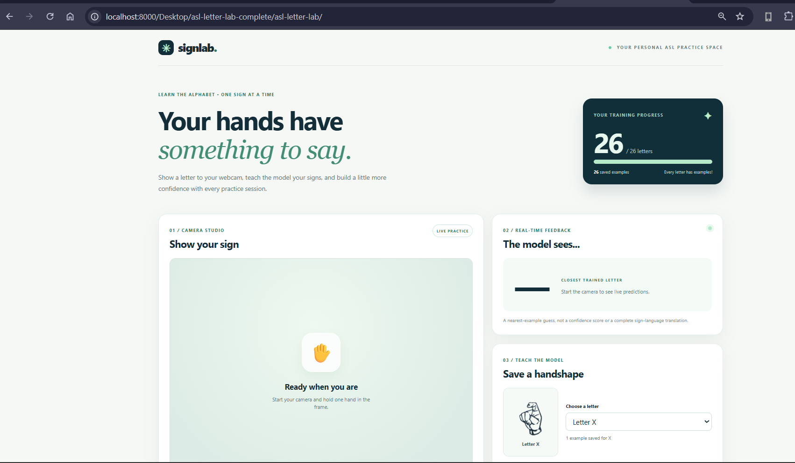

# SignLab - ASL Alphabet Trainer

An improved version of the LU09 Machine Vision ASL browser app, built using HTML, CSS, JavaScript, and the ml5 handPose library.

SignLab lets a person practice the ASL alphabet with a webcam. 

The camera looks at a hand, the app finds hand points, and then it makes a guess about which letter the person is trying to sign. 

What I like about this project is that it feels interactive. Instead of just looking at a poster of handshapes, the user gets to practice, save examples, and see a live guess on the screen.

## Run the app

1. Download/extract this project and keep `index.html`, `style.css`, `app.js`, and the `assets` folder together.
2. In this project folder, launch a local web server: `python -m http.server 8000`.
3. Open **http://localhost:8000** in a browser with a webcam and internet connection (needed for the ml5 library and its model files). Alternatively, publish the folder on an HTTPS website such as GitHub Pages.
4. Click **Start camera** and allow camera access when prompted. Hold **one hand** in the camera frame.
5. Choose the letter you're signing, then click **Save example** several times with slightly different poses. As you collect examples, the **Model guess** area displays the label of the saved example closest to your hand.
6. Use **Reset this letter** to delete only the examples for the current letter. **Clear all examples** removes the whole personal training set after confirmation.
7. In the **Word playground**, select **Generate word** and use **Next letter** to move through its handshapes. It does **not** automatically advance based on the classifier's guesses.

**Note:** The camera needs a secure origin (HTTPS or `localhost`). Opening `index.html` directly with a `file://` URL is not recommended.

## Improvements

I improved the app in a few ways that make it feel more complete and easier to use. 

**1. Cleaned up the design so it looks nicer and is easier to understand. 

**2.I changed the single big alphabet chart into separate images for each letter, which makes the reference section much more useful. 

**3. I added all 26 letters, a way to reset just one letter at a time, and localStorage so the user's progress stays saved even after refreshing the page. 

**4. Added a word generator so people can practice a full word instead of only one letter at a time.

## How recognition works

Each video frame is copied to a canvas. `ml5.handPose()` estimates 21 hand landmarks. SignLab subtracts wrist coordinates from the landmarks, then divides by palm width, turning them into **42 normalized numbers**. When you click Save example, those 42 numbers are stored with the letter label you selected. For each detected hand, the app finds the stored example with the **smallest sum of squared differences** and displays its label. This is one-nearest-neighbor matching, not a pretrained 26-letter recognizer.

## Important considerations/limits to the app:

- Recognition depends on how many examples the user saves and how similar the current viewpoint is. Predictions may be wrong; there is no calibrated confidence score.
- **J and Z involve movement.** This one-frame classifier cannot recognize the full movement path, even though their reference images include arrows.
- The app recognizes only one detected hand per frame and does not interpret whole signs, facial expressions, or ASL grammar.
- Webcam video frames are processed in the browser; this app does not upload or save frames. Saved examples are numeric normalized hand landmarks, stored locally in browser storage. ml5 code/model files are fetched online.
- If localStorage is disabled or full, the app can still practice in the current tab but might not be able to save progress.

## Submission files

- `index.html`, `style.css`, `app.js` - complete app source
- `assets/letters/` - 26 individual ASL handshape images
- `docs/recognition-flowchart.pdf` - full-page printable letter-guess flowchart
- `docs/recognition-flowchart.png` - easy-to-submit image of the flowchart
- `docs/recognition-flowchart.mmd` - editable Mermaid source
- `docs/write-up.pdf` - one-page write-up on accessibility, communication, privacy, surveillance, and military use
- `docs/write-up.md` - editable text of the write-up

